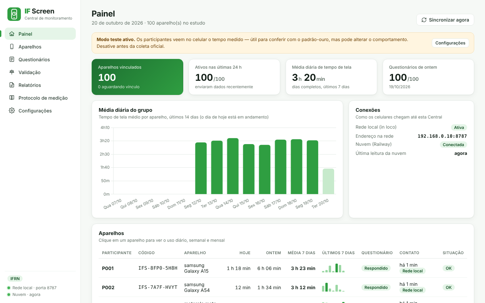
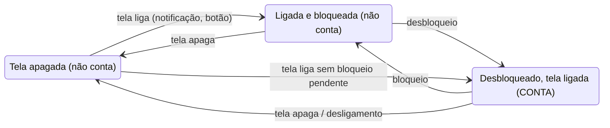
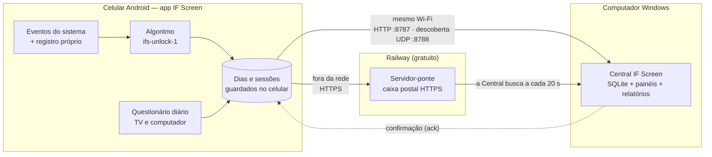
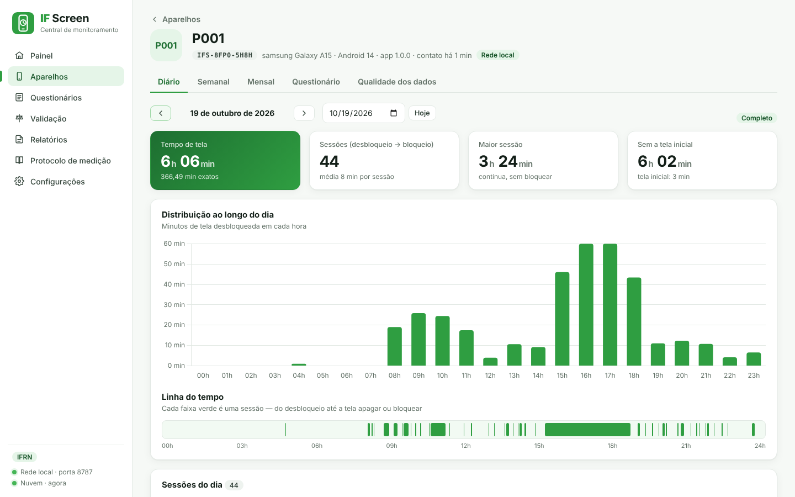
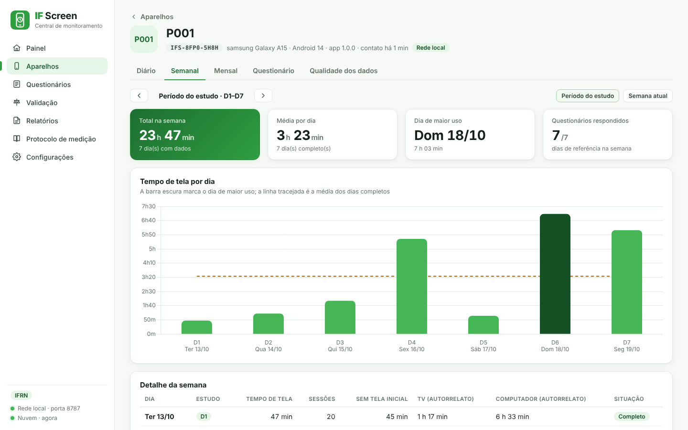
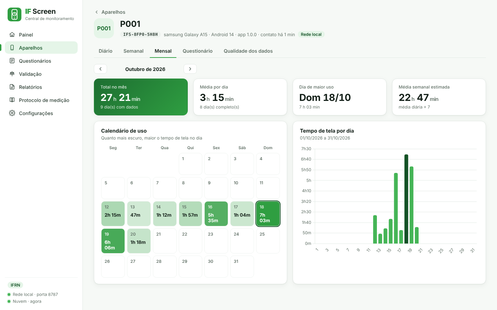
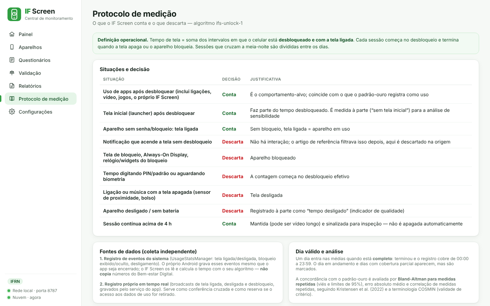
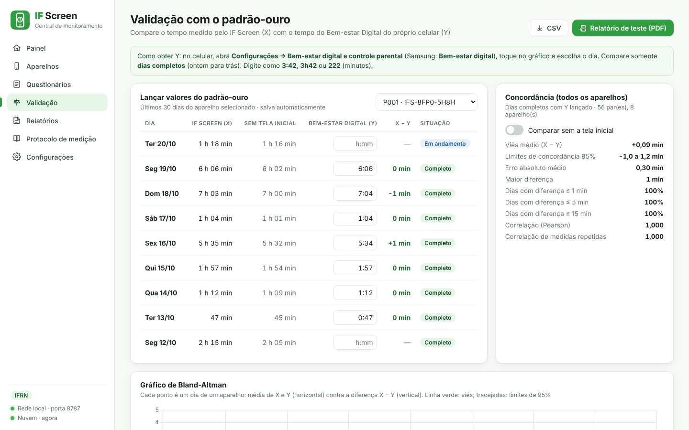

# IF Screen

**Sistema de pesquisa para medir somente o tempo de tela de smartphones Android, tendo o Bem-estar Digital do próprio Android como padrão-ouro.**

Projetado para um estudo do **IFRN** com **100 celulares durante 7 dias, 24 horas por dia**. São três partes:

- um **app Android** que mede o tempo de tela e aplica um questionário diário;
- uma **Central Windows** (`.exe`) que recebe, organiza e analisa os dados;
- um **servidor-ponte gratuito no Railway** para os celulares que estão fora da rede da Central.

| | |
|---|---|
| 📄 [Manual de uso (PDF)](docs/IF-Screen-Manual-de-Uso.pdf) | Instalação, vínculo, rotina, testes e solução de problemas |
| 📑 [Artigo do projeto (PDF)](docs/IF-Screen-Artigo.pdf) | Métodos, algoritmo, verificação técnica e protocolo de validação |
| 📊 [Planilha de teste X × Y](docs/IF-Screen-Relatorio-de-Teste.xlsx) | Compara o IF Screen com o Bem-estar Digital e dá o veredito |
| 📐 [Métricas: o que conta e o que é descartado](docs/METRICAS.md) | Definição operacional completa |


<sub>Painel da Central com 100 aparelhos (dados simulados).</sub>

---

## Sumário

1. [O que é medido](#1-o-que-é-medido)
2. [Como funciona](#2-como-funciona)
3. [Estrutura do repositório](#3-estrutura-do-repositório)
4. [Instalação passo a passo](#4-instalação-passo-a-passo)
5. [Uso no dia a dia](#5-uso-no-dia-a-dia)
6. [Teste contra o padrão-ouro](#6-teste-contra-o-padrão-ouro)
7. [Relatórios e dados exportados](#7-relatórios-e-dados-exportados)
8. [Protocolo de coleta: 100 celulares, 7 dias](#8-protocolo-de-coleta-100-celulares-7-dias)
9. [Testes e verificação técnica](#9-testes-e-verificação-técnica)
10. [Referência técnica](#10-referência-técnica)
11. [Privacidade e segurança](#11-privacidade-e-segurança)
12. [Solução de problemas](#12-solução-de-problemas)
13. [Limitações conhecidas](#13-limitações-conhecidas)
14. [Referências](#14-referências)

---

## 1. O que é medido

**Tempo de tela = soma dos intervalos em que o celular está desbloqueado e com a tela ligada.**

- Cada sessão **começa no desbloqueio**.
- A sessão **termina** quando a tela apaga, o aparelho bloqueia ou desliga.
- Sessões que cruzam a meia-noite são divididas entre os dias, no fuso do aparelho.

O algoritmo se chama **`ifs-unlock-1`**.

| Situação | Decisão |
|---|---|
| Uso de qualquer app após desbloquear (inclui ligação com a tela acesa e o próprio IF Screen) | ✅ Conta |
| Tela inicial (launcher) após desbloquear | ✅ Conta, e também é medida à parte |
| Celular sem senha/bloqueio, com a tela ligada | ✅ Conta |
| Sessão contínua acima de 4 h | ✅ Conta, e é sinalizada para inspeção |
| Notificação que acende a tela sem desbloqueio | ❌ Descarta |
| Tela de bloqueio, Always-On Display, widgets do bloqueio | ❌ Descarta |
| Tempo digitando PIN/padrão ou esperando a biometria | ❌ Descarta |
| Ligação, música ou vídeo com a tela apagada | ❌ Descarta |
| Aparelho desligado ou sem bateria | ❌ Descarta (registrado à parte como “tempo desligado”) |

Um **dia completo** é o que já terminou e cujo registro cobre de 00:00 a 23:59. Só dias completos entram nas médias.

A tabela completa, com justificativas, está em [`docs/METRICAS.md`](docs/METRICAS.md).

### Coleta independente

O IF Screen **não copia** o número do Bem-estar Digital. O tempo é calculado pelo próprio algoritmo, a partir de duas fontes:

1. **Registro de eventos do sistema** (`UsageStatsManager`). É a fonte principal.
   - O Android grava esses eventos mesmo se o app for encerrado.
   - Um período em que o fabricante parou o app é recuperado no cálculo seguinte.
2. **Registro próprio em tempo real.** O serviço do app grava os eventos tela ligada, tela desligada e desbloqueio (`USER_PRESENT`).
   - Serve de conferência cruzada.
   - Também é a reserva caso a permissão de acesso aos dados de uso seja retirada.



---

## 2. Como funciona



**O dado só sai da fila do celular quando a Central confirma o recebimento.**

- Cada dia calculado tem uma versão.
- A Central só aceita uma versão mais nova do que a que já tem.
- O celular reenvia o que não foi confirmado.

Por isso, se a ponte for apagada, reiniciada ou ficar sem crédito, **nenhum dado se perde**. Os dados ficam no celular e chegam pela rede local ou quando a ponte voltar.

| Parte | Tecnologia | Função |
|---|---|---|
| `android/` | Kotlin, Android 9+ (minSdk 28), WorkManager | Mede, guarda localmente, sincroniza, aplica o questionário |
| `central/` | Electron 44, SQLite (sql.js/WebAssembly), Chart.js | Recebe dados, vincula celulares, painéis diário/semanal/mensal, validação Bland-Altman, PDF e CSV |
| `relay/` | Node.js ≥ 18, sem dependências | Ponte na nuvem entre os celulares e a Central |

---

## 3. Estrutura do repositório

```
ifscreen/
├── android/                    App Android (projeto Gradle)
│   └── app/src/main/java/br/edu/ifrn/ifscreen/
│       ├── ScreenTimeEngine.kt   algoritmo ifs-unlock-1
│       ├── DayStore.kt           cálculo e armazenamento dos dias
│       ├── SyncManager.kt        sincronização rede local / nuvem
│       ├── MonitorService.kt     serviço permanente em segundo plano
│       ├── Notifier.kt           notificação do questionário
│       └── *Activity.kt          telas (início, questionário, medições)
├── central/                    Central Windows (Electron)
│   ├── main.js, preload.js
│   ├── src/                      banco, servidor local, sincronização, estatística, CSV
│   ├── renderer/                 interface (HTML/CSS/JS)
│   └── build/                    ícone, instalador NSIS, regras de firewall
├── relay/                      Servidor-ponte (Railway)
├── tools/
│   ├── algorithm/                algoritmo de referência + testes
│   ├── simulator/                teste ponta a ponta com 100 aparelhos
│   ├── kotlin-check/             compila o app e testa o motor sem SDK Android
│   └── ui-preview/               pré-visualiza a Central no navegador
├── docs/                       manual, artigo, planilha, métricas, imagens
└── .github/workflows/          build automático do APK e do instalador
```

---

## 4. Instalação passo a passo

### Requisitos

| Item | Requisito |
|---|---|
| Computador da Central | Windows 10/11 64 bits, 4 GB de RAM, 1 GB livre |
| Celulares | Android 9 ou superior, data e hora automáticas |
| Rede local | Central e celulares no mesmo Wi-Fi, sem isolamento entre aparelhos |
| Nuvem | Conta no GitHub e conta gratuita no Railway |

### Passo 1 — Servidor-ponte no Railway (gratuito)

1. Envie este repositório para o seu GitHub.
2. Em [railway.com](https://railway.com), entre com o GitHub e crie um projeto com **Deploy from GitHub repo**.
3. No serviço, abra **Settings → Source → Root Directory** e informe `relay`.
4. Em **Variables**, crie as variáveis:

   | Variável | Valor |
   |---|---|
   | `CENTRAL_KEY` | uma senha longa e secreta, usada pela Central |
   | `APP_KEY` | `ifscreen-app-key` (ou outra; precisa ser igual no app e na Central) |
   | `RATE_LIMIT_PER_MIN` | opcional, padrão `600` requisições por minuto por IP |
   | `DATA_DIR` | opcional, pasta de um Volume para guardar o estado |

5. Em **Settings → Networking**, clique em **Generate Domain** e anote o endereço.
6. Abra `https://SEU-ENDERECO/health` no navegador. A resposta deve conter `"ok":true`.

> O plano Free do Railway dá US$ 1 de crédito por mês e até 0,5 GB de RAM por serviço. Antes disso, há um teste de 30 dias com US$ 5. A ponte usa cerca de 50 MB.

### Passo 2 — Central no Windows

**Opção A — usar o instalador pronto**

1. Execute `IF-Screen-Central-Setup-1.0.0.exe`.
   - O instalador não tem assinatura comercial, então o Windows pode avisar.
   - Nesse caso, clique em **Mais informações → Executar assim mesmo**.
2. O instalador cria os atalhos e libera no Firewall as portas **TCP 8787** e **UDP 8788**.

**Opção B — gerar o instalador pelo GitHub**

1. Abra **Actions → Gerar instalador da Central (Windows) → Run workflow**.
2. Baixe o artefato `IF-Screen-Central-Setup`.

**Opção C — gerar localmente** (Windows, Node 22 e NSIS instalados)

```bash
cd central
npm ci
npm run dist:win        # gera dist/IF-Screen-Central-Setup-1.0.0.exe
```

**Configurar a Central** (menu **Configurações**)

- **Nuvem (Railway):**
  1. Ative a opção.
  2. Cole o endereço do servidor, a `CENTRAL_KEY` e a `APP_KEY`.
  3. Clique em **Testar conexão**.
- **Estudo:** escolha o horário da notificação (padrão 09:00) e do lembrete (padrão 20:00).
- **Modo teste:** deixe ligado só durante a comparação com o padrão-ouro.
- **Identidade:** escolha o arquivo oficial da logomarca do IFRN.

Os dados ficam em `%APPDATA%\IF Screen Central`. Há cópias de segurança automáticas dos últimos 14 dias.

### Passo 3 — Gerar o APK do app

**Opção A — GitHub Actions** (não precisa instalar nada)

1. Abra **Actions → Gerar APK do IF Screen → Run workflow**.
2. Preencha os campos:
   - **Endereço do servidor-ponte:** o endereço do Railway. Também pode ficar vazio e ser preenchido depois, no app.
   - **APP_KEY:** a mesma usada no Railway e na Central.
3. Espere de 5 a 8 minutos.
4. Baixe o artefato **IF-Screen-apk**. Ele contém `IF-Screen-1.0.0.apk`.

**Opção B — Android Studio**

1. Abra **somente a pasta `android`** em **File → Open**.
2. Aguarde a sincronização do Gradle.
3. Use **Build → Build App Bundle(s) / APK(s) → Build APK(s)**.

**Opção C — linha de comando** (JDK 17 + Android SDK)

```bash
cd android
./gradlew assembleRelease -PIFSCREEN_RELAY_URL="https://SEU-ENDERECO" -PIFSCREEN_APP_KEY="ifscreen-app-key"
# APK: android/app/build/outputs/apk/release/app-release.apk
```

Todas as opções assinam o APK com a mesma chave do projeto (`android/app/ifscreen-release.jks`). Assim, uma atualização instala por cima sem apagar os dados do celular.

### Passo 4 — Instalar nos celulares

1. Copie o APK para o celular e toque nele. Autorize **"Instalar apps desta fonte"**.
2. Abra o IF Screen e conceda as três permissões do cartão amarelo:
   - **Acesso aos dados de uso** — obrigatório. Sem ele, o app não mede.
   - **Notificações** — necessárias para o questionário diário.
   - **Bateria sem restrição.**
3. Em **Xiaomi, Huawei, Realme e Motorola**, ative também **Início automático** em **Ajustes do app**.
4. Confira se aparece a notificação fixa **"IF Screen ativo"**.

### Passo 5 — Vincular cada celular pelo código único

1. Na primeira abertura, o app gera um código como `IFS-7K3M-Q9PD`.
   - São 8 caracteres, sem as letras I, L, O e U.
   - O código não muda enquanto o app estiver instalado.
2. Com o celular no mesmo Wi-Fi ou com internet, abra a Central em **Aparelhos**.
3. Digite o código e a identificação do participante (ex.: `P001`).
4. Clique em **Vincular**.

Se a descoberta automática não funcionar na rede, toque em **Conexão** no app. Digite o endereço mostrado em **Configurações → Rede local** da Central (ex.: `192.168.0.10:8787`).

---

## 5. Uso no dia a dia

**Participante.** A medição roda sozinha em segundo plano. A única tarefa é o questionário diário (cerca de 20 segundos):

- No horário configurado, chega a notificação.
- As perguntas são sobre **ontem**, da meia-noite à meia-noite:
  - Assistiu TV? Por quanto tempo?
  - Usou computador ou notebook? Por quanto tempo?
- Se não responder, um lembrete chega no horário configurado.
- A resposta pode ser corrigida até o fim do dia seguinte.

**Pesquisador.** Clique em um celular no painel da Central para abrir as abas:

| Aba | Conteúdo |
|---|---|
| **Diário** | Total, sessões, maior sessão, valor sem tela inicial, gráfico por hora e linha do tempo dos desbloqueios |
| **Semanal** | 7 barras, dia de maior uso em destaque, média dos dias completos; botão **Período do estudo** (D1–D7); respostas de TV e computador |
| **Mensal** | Calendário colorido pela intensidade, total e média |
| **Questionário** | Respostas e médias de TV e computador |
| **Qualidade dos dados** | Permissões, bateria, data/hora automática; por dia: cobertura, fonte, registro próprio, tempo desligado |

| Diário | Semanal |
|---|---|
|  |  |

| Mensal | Protocolo de medição |
|---|---|
|  |  |

O painel mostra estes alertas:

- “Sem contato há mais de 3 h”
- “Acesso ao uso desativado”
- “Otimização de bateria ativa”
- “Notificações bloqueadas”
- “Data/hora manual”

---

## 6. Teste contra o padrão-ouro

Compare, no mesmo celular e no mesmo **dia completo** (ontem ou antes):

- **X** = tempo medido pelo IF Screen.
- **Y** = tempo exibido pelo Bem-estar Digital.

1. Ligue o **Modo teste** na Central. O celular passa a mostrar o tempo medido em **Minhas medições**.
2. Anote X e Y:
   - **Y:** no celular, abra **Configurações → Bem-estar digital e controle parental**, toque no gráfico e escolha o dia.
   - No Samsung, o caminho é **Bem-estar digital**.
3. Registre os valores em um destes lugares:
   - **Central → Validação:** digite Y como `3:42`, `3h42` ou `222`. X já está na Central.
   - **[Planilha de teste](docs/IF-Screen-Relatorio-de-Teste.xlsx):** preencha as células amarelas.
4. Gere o PDF em **Validação → Relatório de teste (PDF)**.



| Medida | Meta do IF Screen | Aceitável |
|---|---|---|
| Viés médio (X − Y) | até ±1 min/dia | até ±5 min/dia |
| Limites de concordância 95% (Bland-Altman) | dentro de ±5 min | dentro de ±15 min ([Kristensen et al., 2022](https://doi.org/10.1016/j.chbr.2021.100164)) |

Diferença de **1 minuto** é arredondamento: o Bem-estar Digital exibe minutos inteiros.

Se um modelo mostrar X sistematicamente maior, ative **"Comparar sem a tela inicial"**. Alguns fabricantes não somam a tela inicial no Bem-estar Digital.

**Desligue o Modo teste antes da coleta oficial.** Ver o próprio tempo pode mudar o comportamento do participante.

---

## 7. Relatórios e dados exportados

Em **Relatórios**, escolha o período:

| Saída | Formato | Conteúdo |
|---|---|---|
| Relatório de teste e avaliação | PDF | X × Y dia a dia, viés, limites, Bland-Altman, veredito |
| Ficha de teste em branco | PDF | Para anotar X e Y à mão |
| Relatório do estudo | PDF | Por participante: dias completos, média, dia de maior uso, TV e computador |
| Tempo de tela diário | CSV | Uma linha por celular e dia, com indicadores de qualidade |
| Sessões | CSV | Início e fim de cada sessão (inclui epoch em ms) |
| Questionários | CSV | TV e computador por dia de referência |
| Validação | CSV | Pares X × Y, inclusive sem tela inicial |

Os CSV usam `;` como separador e vírgula decimal (padrão do Excel em português). R, SPSS e Stata também leem.

<details>
<summary>Colunas do CSV diário</summary>

`participante; codigo; data; tempo_tela_min; tempo_sem_tela_inicial_min; tela_inicial_min; proprio_app_min; registro_proprio_min; aparelho_desligado_min; sessoes; sessoes_longas_4h; dia_completo; cobertura_parcial; fonte; algoritmo; canal; recebido_em`

</details>

---

## 8. Protocolo de coleta: 100 celulares, 7 dias

**Uma semana antes**

- [ ] Ponte respondendo em `/health`; Central mostrando “Nuvem conectada”
- [ ] Piloto com 3 a 5 celulares de marcas diferentes, por 3 dias completos, comparando com o Bem-estar Digital
- [ ] Decidir se a análise usa o tempo total ou a variante sem tela inicial
- [ ] Termo de consentimento aprovado pelo Comitê de Ética

**D0 — instalação**

- [ ] APK instalado, três permissões concedidas, notificação “IF Screen ativo” visível
- [ ] Início automático e bateria sem restrição (Xiaomi, Huawei, Realme, Motorola)
- [ ] Data e hora automáticas
- [ ] Vínculo pelo código; anotar código × participante
- [ ] **Modo teste desligado**

**D1 a D7**

- [ ] Todo dia, no painel: tratar alertas e celulares sem contato
- [ ] Acompanhar “Questionários de ontem”

**D8 — recolhimento**

- [ ] Cada participante abre o app no Wi-Fi da Central e toca em **Sincronizar agora**
- [ ] Conferir 7 dias completos em **Semanal → Período do estudo**
- [ ] Se for validar: anotar o Bem-estar Digital de D1 a D7 (ele guarda cerca de 1 semana)
- [ ] Exportar os CSV e o relatório do estudo; copiar a pasta de dados

---

## 9. Testes e verificação técnica

```bash
node tools/algorithm/test.js        # 9 cenários do algoritmo
cd relay && node test.js && cd ..   # servidor-ponte
cd central && npm ci && cd ..
node tools/simulator/simulate.js    # 100 aparelhos × 7 dias, ponta a ponta
bash tools/kotlin-check/check.sh    # compila o app e testa o motor Kotlin (sem SDK Android)
```

**Simulação ponta a ponta.** O simulador gera eventos brutos realistas do Android para 100 aparelhos:

- notificações que acendem a tela sem desbloqueio;
- tempo digitando PIN;
- atraso de bloqueio;
- aparelhos sem senha;
- reinicializações e falta de bateria;
- vídeos longos;
- eventos duplicados.

Os aparelhos sincronizam assim:

- 40 só pela rede local;
- 45 só pela nuvem;
- 15 alternando entre as duas;
- 10% passam um dia inteiro sem conexão;
- a ponte **perde todo o estado no 3º dia**.

Ao final, os totais gravados na Central são comparados, ao milissegundo, com o valor verdadeiro.

| Indicador (20/10/2026) | Resultado |
|---|---|
| Aparelho-dias idênticos ao valor verdadeiro | **700 / 700** |
| Maior diferença | **0 ms** |
| Dias ausentes · sessões divergentes | 0 · 0 |
| Questionários recebidos | 700 / 700 |
| Eventos brutos processados | 224.919 |
| Acendimentos de tela sem desbloqueio descartados | ≈ 10,3 mil |
| Motor Kotlin do app (paridade com a referência) | **210 / 210** aparelho-dias, 0 ms |

Resultado bruto em [`docs/resultado-simulacao.json`](docs/resultado-simulacao.json).

> A simulação verifica a cadeia de cálculo, transmissão e armazenamento. A **concordância com o Bem-estar Digital em aparelhos reais** é medida pelo protocolo da seção 6 e 8. Os resultados de campo devem ser registrados no artigo, seção 3.4.

**Pré-visualizar a Central no navegador** (sem Electron):

```bash
node tools/ui-preview/server.js caminho/do/banco.db 5199   # abre em http://127.0.0.1:5199
```

---

## 10. Referência técnica

### Eventos do Android usados

| Código | Evento | Uso |
|---|---|---|
| 15 / 16 | `SCREEN_INTERACTIVE` / `SCREEN_NON_INTERACTIVE` | Tela ligada / apagada |
| 17 / 18 | `KEYGUARD_SHOWN` / `KEYGUARD_HIDDEN` | Bloqueio exibido / desbloqueio |
| 26 / 27 | `DEVICE_SHUTDOWN` / `DEVICE_STARTUP` | Desligamento / inicialização |
| 1 / 2 / 23 | `ACTIVITY_RESUMED` / `PAUSED` / `STOPPED` | Só para medir à parte a tela inicial e o próprio app; não sai do celular |

### API

Os celulares falam com a Central (rede local, `http://IP:8787`) e com a ponte (`https://…`) pelos **mesmos endpoints**.

| Método e rota | Quem chama | Autenticação | Função |
|---|---|---|---|
| `POST /api/v1/device/register` | celular | `x-app-key` | Cadastro: `deviceId`, `code`, `token`, `info` |
| `POST /api/v1/device/ingest` | celular | `x-device-id` + `x-device-token` | Envia `days[]`, `questionnaires[]`, `heartbeat` |
| `GET /api/v1/device/status` | celular | `x-device-id` + `x-device-token` | Vínculo, configuração e versões confirmadas pela Central |
| `GET /api/v1/central/pull?after=N` | Central → ponte | `Authorization: Bearer CENTRAL_KEY` | Lê novidades por cursor |
| `POST /api/v1/central/ack` | Central → ponte | `Bearer` | Confirma o que gravou |
| `POST /api/v1/central/links` | Central → ponte | `Bearer` | Republica vínculos e configuração |
| `GET /health` | qualquer um | — | Saúde do serviço |

Descoberta na rede local:

1. O celular envia `IFSCREEN_DISCOVER` por broadcast UDP na porta 8788.
2. A Central responde `{"service":"ifscreen-central","port":8787}`.

<details>
<summary>Exemplo de dia enviado pelo celular</summary>

```json
{
  "date": "2026-10-19",
  "screenMs": 13286000,
  "launcherMs": 194000,
  "ownAppMs": 41000,
  "deviceOffMs": 0,
  "sessions": [[1792404183000, 1792404921000], [1792407712000, 1792408005000]],
  "longSessions": 0,
  "complete": true,
  "partialCoverage": false,
  "ownLogMs": 13281000,
  "source": "usagestats",
  "algo": "ifs-unlock-1",
  "tz": "America/Fortaleza",
  "computedAt": 1792465260000
}
```

</details>

### Configuração do app

O endereço da nuvem e a `APP_KEY` podem ser definidos de três formas:

- em `android/gradle.properties` (`IFSCREEN_RELAY_URL`, `IFSCREEN_APP_KEY`);
- por `-P` na linha de comando;
- nas entradas do workflow.

O endereço também pode ser alterado no próprio app, em **Conexão**.

A Central envia ao app, a cada sincronização:

- o horário do questionário;
- o horário do lembrete;
- o modo teste;
- o endereço da nuvem.

---

## 11. Privacidade e segurança

**O que sai do celular:**

- horários de início e fim das sessões;
- totais diários;
- respostas do questionário;
- dados técnicos (modelo, versão do Android, permissões, bateria).

**Nada além disso sai do celular:** nenhum nome de app, conteúdo, mensagem, foto, contato ou localização.

**Como os dados são protegidos:**

- **Token por aparelho.** Cada celular tem um token secreto de 256 bits. A Central e a ponte guardam só o hash SHA-256.
- **Chaves de acesso.** A ponte exige a `APP_KEY` para cadastrar celulares. A Central se autentica na ponte com a `CENTRAL_KEY`.
- **Tráfego.** A nuvem usa HTTPS. A rede local usa HTTP, então use um Wi-Fi controlado pela equipe.
- **Retenção na ponte.** A ponte apaga o conteúdo já confirmado depois de 2 dias.
- **Chave de assinatura do APK.** `android/app/ifscreen-release.jks`, senha `ifscreen2026`, serve para o estudo. **Para publicar o app fora da pesquisa, gere uma chave nova** e informe as senhas por `-PIFSCREEN_STORE_PASSWORD` e `-PIFSCREEN_KEY_PASSWORD`.

O estudo de campo deve passar pelo Comitê de Ética em Pesquisa e seguir a LGPD.

---

## 12. Solução de problemas

| Sintoma | O que fazer |
|---|---|
| App mostra “Permissão necessária” | Ativar **Acesso aos dados de uso** para o IF Screen |
| Código não aparece na Central | **Sincronizar agora** no app; conferir Wi-Fi/internet e se a `APP_KEY` é igual no app, na Central e no Railway |
| Central não acha celulares no Wi-Fi | A rede pode isolar aparelhos: digitar o IP da Central em **Conexão** ou usar a nuvem |
| “Nuvem com erro” | Testar conexão; abrir `/health`; conferir `CENTRAL_KEY` e o crédito do Railway |
| Celular “sem contato há mais de 3 h” | Nada se perde (fica no celular); ajustar bateria e início automático |
| X maior que o Bem-estar Digital | Comparar com **sem tela inicial** |
| Dia com “Cobertura parcial” | Normal no dia da instalação; excluir da análise |
| Fonte “Registro próprio” | A permissão de uso foi retirada; reativar |
| Porta 8787 ocupada | Trocar em Configurações e informar o novo endereço no app |

---

## 13. Limitações conhecidas

- **Algoritmo do padrão-ouro não é público.** O Google não divulga como o Bem-estar Digital calcula o total. Por isso, uma concordância de 100% não pode ser garantida a priori. Ela é medida pelo protocolo de validação, com análise por fabricante.
- **Apenas Android 9 ou superior.** iOS não é suportado.
- **Histórico curto do padrão-ouro.** O Bem-estar Digital guarda cerca de 1 semana. Registre Y até D8.
- **Questionário de TV e computador é autorrelato.** Está sujeito a viés de recordação.
- **APK sem assinatura comercial.** É instalado manualmente, sem a Play Store.
- **Instalador sem assinatura de código.** O Windows SmartScreen pode avisar ao executar.

---

## 14. Referências

1. Kristensen, P. L. et al. (2022). Criterion validity of a research-based application for tracking screen time on android and iOS smartphones and tablets. *Computers in Human Behavior Reports*, 5, 100164. https://doi.org/10.1016/j.chbr.2021.100164
2. Mokkink, L. B. et al. (2010). The COSMIN study reached international consensus on taxonomy, terminology, and definitions of measurement properties. *Journal of Clinical Epidemiology*, 63, 737–745. https://doi.org/10.1016/j.jclinepi.2010.02.006
3. Gagnier, J. J. et al. (2021). COSMIN reporting guideline for studies on measurement properties of patient-reported outcome measures. *Quality of Life Research*, 30, 2197–2218. https://doi.org/10.1007/s11136-021-02822-4
4. Bland, J. M., & Altman, D. G. (2007). Agreement between methods of measurement with multiple observations per individual. *Journal of Biopharmaceutical Statistics*, 17(4), 571–582.
5. Bland, J. M., & Altman, D. G. (1995). Calculating correlation coefficients with repeated observations. *BMJ*, 310, 446.

---

<sub>IF Screen 1.0.0 · algoritmo ifs-unlock-1 · Projeto de pesquisa IFRN. Os arquivos `package.json` declaram licença MIT; adicione um arquivo `LICENSE` se for publicar o repositório.</sub>
